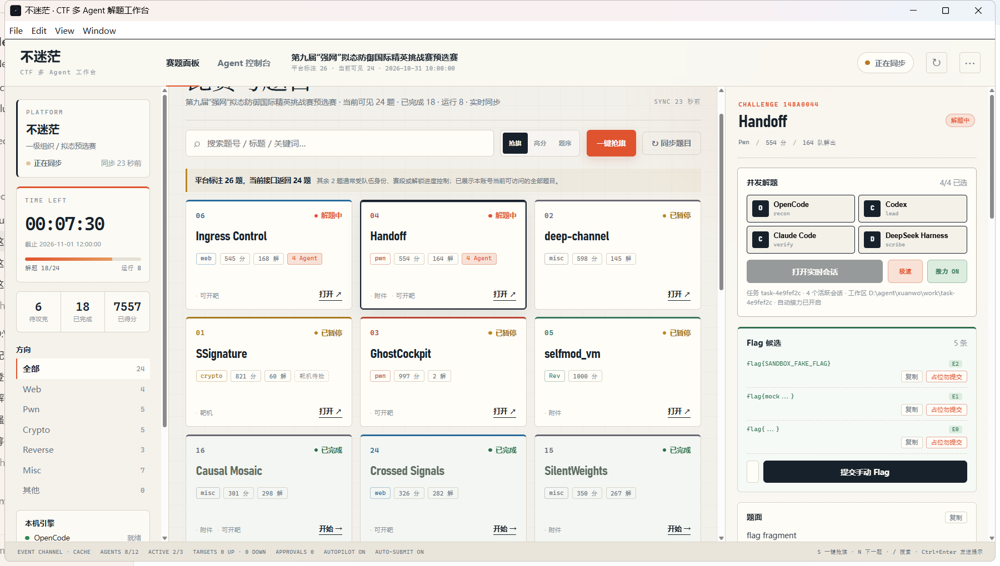
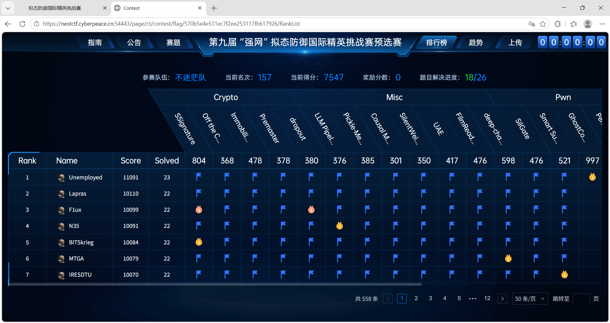
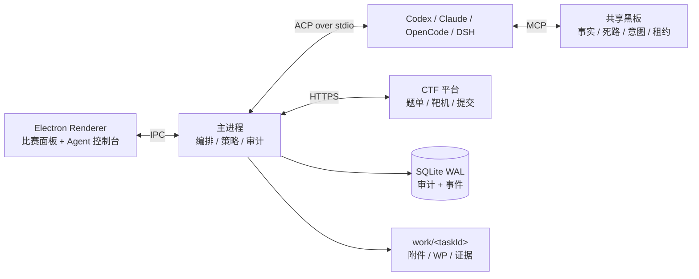

# 不迷茫 · Multi-Agent CTF Workbench

[](https://github.com/xuanwoLQL/bumimang-ctf-workbench/actions/workflows/ci.yml)
[](LICENSE)

> 把本机已安装的 Codex、Claude Code、OpenCode、DeepSeek Harness 组织成一支可并行解题、共享证据、自动校验与提交的 CTF 工作台。



## 它是什么

“不迷茫”不是又一个内置工具箱，而是一层轻量的多 Agent 编排与观测层：

- **平台连接**：Nest/CyberPeace、CTFd、CTFy MCP 适配；同步题单、附件、靶机与排名。
- **多 Agent 并行**：每题最多 4 个 Agent，全局最多 12 个；自动选择 3 道优先题。
- **共享黑板**：事实、死路、意图、资源租约和证据统一协调，避免重复劳动。
- **证据驱动**：E0/E1/E2 分级；E2 候选可自动提交，平台拒绝后结构化回灌。
- **本地 WP 检索**：按题名、方向和关键词，只复制最相关的少量题解与脚本。
- **低延迟 UI**：隐藏视图不渲染，分区脏检查，高频事件合并，实测切换 p95 16.6 ms。
- **轻量工具边界**：不重复打包 Nmap、Wireshark、Volatility 等工具；使用本机已有环境。

本项目只用于明确授权的 CTF、靶场和自有资产。

## 当前比赛结果

第九届“强网”拟态防御国际精英挑战赛预选赛：

- 平台可访问题：24
- 平台完成：18
- 排行榜截图：第 157 名，7547 分，18/26
- 本地终态快照折算：7555 分（动态计分）
- 本地保留并确认的已接受 flag：14

完整台账：[`ctf/nest-2026/competition-ledger.md`](ctf/nest-2026/competition-ledger.md)  
本方向 WP 与复现脚本：[`ctf/nest-2026/`](ctf/nest-2026/)

排行榜证据：



## 架构



核心模块：

| 模块 | 职责 |
| --- | --- |
| `apps/desktop/src/main/platform` | 平台登录、题单同步、附件、靶机、提交 |
| `apps/desktop/src/main/session` | Agent 会话、扇出、角色、停止与收尾 |
| `apps/desktop/src/main/blackboard` | 唯一写入者、事件广播、租约 |
| `apps/desktop/src/main/answer` | flag/答案识别、文件扫描、归一化 |
| `apps/desktop/src/main/briefing` | 题型 playbook、WP/技能路由、任务简报 |
| `apps/desktop/src/renderer/competition` | 比赛面板、题单、靶机健康、低延迟渲染 |
| `packages/shared-protocol` | 主进程与渲染进程事件契约 |

## 快速开始

### 下载 Windows 构建

- [便携版 `bumimang-0.1.0-portable.exe`](https://github.com/xuanwoLQL/bumimang-ctf-workbench/releases/download/v0.1.0/bumimang-0.1.0-portable.exe)
- [安装版 `bumimang-0.1.0-setup.exe`](https://github.com/xuanwoLQL/bumimang-ctf-workbench/releases/download/v0.1.0/bumimang-0.1.0-setup.exe)

构建产物使用脱敏示例配置，不包含平台账号、密码、DES key、JWT 或靶机地址。

```text
portable SHA256 2f384ce2a6eb017ece37a139e591d37cbe9556b3f5f47cc0cb329912816e9fea
setup    SHA256 353a77ba24b4c37dfb54eee37512c668f3360875ed8d96131c11c43498cff8fd
```

### 依赖

- Windows 10/11 x64
- Node.js 24+
- 至少一个已登录的 ACP Agent CLI
- 可选：本机已安装的 Wireshark、Volatility、YARA 等安全工具

### 安装

```powershell
git clone https://github.com/xuanwoLQL/bumimang-ctf-workbench.git
cd bumimang-ctf-workbench
Copy-Item config/app.example.json config/app.json
Copy-Item config/platform.example.json config/platform.json
npm install
```

编辑 `config/app.json` 和 `config/platform.json`，填入你自己的比赛信息。真实配置
已被 `.gitignore` 排除，不会被提交。

### 启动

```powershell
$env:NEST_PASS='<平台密码>'
node_modules\electron\dist\electron.exe apps\desktop\src\main\electron\main.ts --no-sandbox
```

或者构建 Windows 包：

```powershell
npm run pack
```

首次使用、快捷键和故障排查见
[`使用说明-不迷茫平台版.md`](使用说明-不迷茫平台版.md)。

## 平台配置

```json
{
  "enabled": true,
  "provider": "auto",
  "baseUrl": "https://your-ctf-platform.example",
  "raceId": "",
  "username": "",
  "teamName": "",
  "desKey": "",
  "insecureTls": false,
  "autoConnect": false,
  "autoSync": false,
  "autoSubmit": false,
  "syncIntervalSeconds": 30,
  "wpDir": "../writeups"
}
```

安全默认值：

- `autoConnect=false`
- `autoSync=false`
- `autoSubmit=false`
- `insecureTls=false`
- `baseUrl`、账号和 DES key 为空

## 四个 Agent 与 12 并发

| Agent | 默认角色 | 接入方式 |
| --- | --- | --- |
| Codex | lead | `codex-acp` / ACP |
| Claude Code | verify | Claude ACP |
| OpenCode | recon | OpenCode ACP |
| DeepSeek Harness | scribe | `dsh --profile acp` |

自动编队按“未解优先、高分优先、健康优先”选择最多 3 道题。单题并发不超过 4，
全局活跃会话不超过 12；同一题已存在的 Agent 不会被重复拉起。

## 低延迟设计

改造前后使用同一台机器、同一份 24 题平台状态压测：

| 指标 | 改造前 | 改造后 |
| --- | ---: | ---: |
| 比赛页可见 DOM 节点 | 2431 | 699 |
| Performance.Nodes | 24466 | 5131 |
| 隐藏 `panes.sync` | 持续 50–150 ms | 0 |
| 帧间隔 | 频繁 100–250 ms longtask | 常规 8.3–8.6 ms |
| 视图切换 p95 | 无法稳定测量 | 16.6 ms |
| 视图切换 longtask | 多次 | 0 |

实现要点：

1. 比赛面板与 Agent 控制台按视图独立订阅。
2. 控制台延迟挂载，返回比赛页后停止消费 stream/health。
3. 主进程在隐藏视图期间丢弃高频 IPC。
4. 比赛页顶栏、侧栏、题卡、详情、状态条分区脏检查。
5. 黑板追加事件 300 ms 合并刷新。

详见 [`docs/PERFORMANCE-V3.md`](docs/PERFORMANCE-V3.md)。

## 第九届强网拟态 WP

已收录：

- Web：Ghost-in-the-Queue、Undercurrent、Crossed Signals
- Pwn：Pending Review、Smart Surveillance Camera、SilGate
- Crypto：dropout、Immobilizer、Off the Curve、Premaster
- Misc：FilmReader、Pickle-Me-Not、LLM Pipeline、UAE、Causal Mosaic、SilentWeights
- Reverse：Wasmnesia、Bootleg Update

说明：平台已判定完成但本地未保留 flag 原值的题目标记为“证据缺口”，不猜测、
不伪造。所有公开脚本中的动态靶机地址均通过环境变量或 `<TARGET_HOST>` 占位。

## 开发与验证

```powershell
npm run smoke
npm run verify:flags
npm run verify:gate
npm run verify:concurrency
npm run verify:hardening
npm run verify:all
```

发布前敏感信息审计：

```powershell
python release-tools/audit_public.py
```

## 仓库结构

```text
apps/                  Electron 主进程、渲染进程和验收程序
packages/              共享协议类型
config/                安全示例配置
docs/                  架构、性能、平台和验收文档
ctf/nest-2026/         第九届强网公开台账、WP、脚本、证据
skill-builtin/         打包用的轻量技能快照
release-tools/         公开资产导出与脱敏审计
```

## 设计取舍

- **不内置大型工具**：复用本机工具链，降低安装包和启动成本。
- **不伪造可见题**：平台权限之外的数据不显示成可操作题目。
- **不把观测当拦截**：不同 Agent 的委托能力不同，界面明确标注真实边界。
- **不承诺精确成本**：只展示可观测的时长和工具调用数。
- **不接受无证据 flag**：E0 候选不会被包装成已确认结果。

## 致谢

架构调研参考了 `verialabs/ctf-agent`、`NYU-LLM-CTF/nyuctf_agents`、
`aielte-research/HackSynth`、`MuWinds/BUUCTF_Agent` 与 `aliasrobotics/cai`
的公开设计。本项目未复制这些项目未经兼容许可的源代码，取舍记录见
[`docs/OPEN-SOURCE-RESEARCH.md`](docs/OPEN-SOURCE-RESEARCH.md)。

## License

MIT。内置技能目录可能保留各自的原始许可与署名，见对应目录中的 `LICENSE`。
