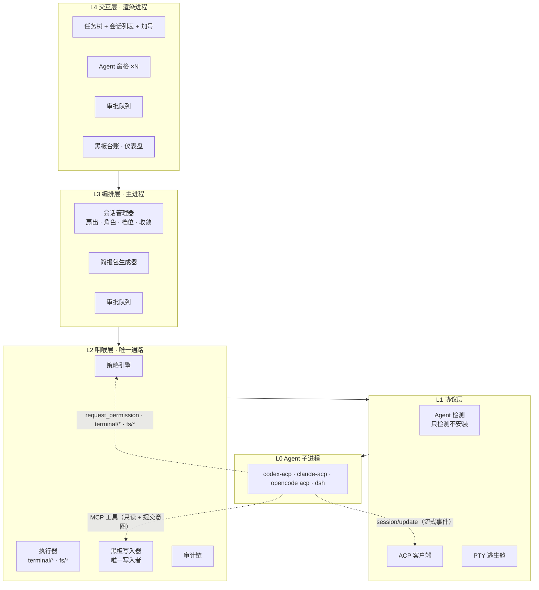
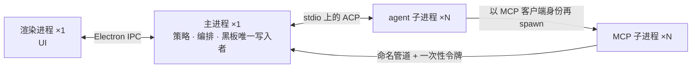
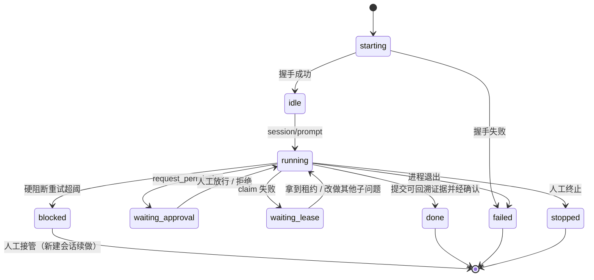
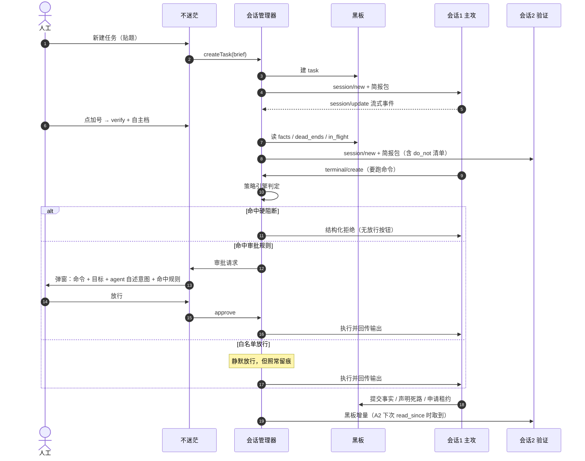

# 不迷茫 · 整体架构文档

**项目名：不迷茫（内部代号 xuanwo）** · 项目目录 `D:\agent\xuanwo`

版本 v0.5（M1 实测修订） · 2026-10-12

---

## 0. 这份文档在回答什么

把"本机上已经装好的几个编码 agent，变成同一道题的多路并行解题队"，用一份共享黑板协调，人工只处理真正的边界。

### 0.1 v0.1 → v0.2 修订记录

| 编号 | 问题 | 处理 |
| --- | --- | --- |
| C2 | 架构层不该硬编码"禁止某类工具" | 改为**可整体替换的策略规则包**，具体限制由当时的比赛规则或使用场景决定（见 9.3） |
| G1 | PTY 逃生舱实质绕过 L2 咽喉点，"强制受控档"自相矛盾 | DSH 降级模式改为**只用于非命令执行类任务**，需要 exec 时 UI 灰掉；PTY 内命令明确标注"无硬拦截"（见 6.3） |
| G2 | 黑板增量怎么进入 agent 上下文没定义 | 新增 7.5「黑板 → agent 同步协议」，定为**拉模式为主 + 唯一一种推模式例外** |
| G3 | "真实输出校验"没有可执行判据 | 降级为**证据链分级 + 人工终判**，给出三类典型情形的处理（见 7.6） |
| G4 | MCP 服务器进程模型未定义 | 新增 4.2「进程与 IPC 模型」 |
| G5 | 并发写入的串行化点没明说 | 立规：**主进程是唯一写入者**，agent 侧不直连 SQLite（见 8.1） |
| Q1 | 意图锁与租约的关系说不清 | intent 是语义层、lease 是资源层，一对多（见 8.4） |
| Q2 | 事实的裁决权归属 | 裁决只有人工，系统只负责高亮冲突（见 8.5） |
| Q3 | 审批时人工看到什么 | 审批卡片改三栏，含 agent 自述意图（见 9.5） |
| Q4 | 拒绝后 agent 收到什么 | 结构化拒绝原因 + 同类重试计数 + 强制暂停（见 9.6） |
| Q5 | DSH 输出侧匹配什么 | 不匹配。降级模式产出一律人工写黑板（见 6.3） |
| Q6 | 成本数据从哪来 | 不承诺精确成本，改展示时长与 tool call 数（见 8.7） |
| Q7 | 崩溃恢复的具体语义 | 明确 intent / lease / 简报包的清理规则（见 8.6） |
| — | 补进程视图、补 skill 模块、schema 语义、目录拆分、术语统一 | 见 4.2 / 5 / 8.2 / 13 / 0 |

### 0.2 v0.2 → v0.3 修订记录

| 编号 | 问题 | 处理 |
| --- | --- | --- |
| A1 | events / 视图表 / audit 三处写入的一致性没定义 | 立规"三写一事务"（见 8.3） |
| A2 | 主进程崩溃后 OS 层子进程没人收 | 子进程全部进 Job Object，`KILL_ON_JOB_CLOSE`（见 4.2 规则 4） |
| A3 | DSH 降级模式的约束被写得像技术强制 | 明确为 **UI 引导与约定**，不做能力承诺（见 6.3） |
| A4 | agent 可能"读不到自己刚写的" | 写类 MCP 工具同步阻塞等待落库（见 5.1、7.4） |
| A5 | `blocked` 会话的进程语义未定 | cancel 后保留 30 秒，超时 kill；"改档位恢复"= 新建会话（见 7.7） |
| B1 | MCP 工具面没有完整清单 | 补 5.1，M1 定稿 |
| B2 | 规则包与配置粒度的关系说不清 | 明确"会话创建时绑定、会话级只追加不整包替换、创建后不变更"（见 9.3） |
| B3 | 冲突会让扇出度瞬间掉到 0 | 冲突按 fact 聚合；只阻塞直接依赖者；提供"暂按候选推进"（见 8.5） |
| B4 | audit 与 events 的关系易被误解成两套日志 | 明确 `audit = events + 哈希链 + 检索索引`（见第 10 节；v0.4 的 A5 进一步修正为"链只留在 events"） |
| C1 | 4.2 图与表在"MCP 子进程的父进程是谁"上不一致 | 改为三步 spawn 顺序，并说明令牌传递路径（见 4.2） |
| C2 | 同步健康度阈值像是硬门槛 | 标注为经验值、可配置（见 7.4） |
| C3 | M1 验收断言引用未声明的前置条件 | 补"先 acquire 一个 lease"步骤，断言重排（见 12 节） |
| C4 | "会话"一词有本地与 ACP 两个含义 | 见 0.4 术语约定 |
| C5 | muteki 借鉴表没区分借用与原创 | 见 15.2 |
| — | 补对外剩余风险与 M2 待实测清单 | 新增第 16 节 |

### 0.3 v0.3 → v0.4 修订记录

| 编号 | 问题 | 处理 |
| --- | --- | --- |
| A1 | 状态机画了 `blocked → running`，与 7.7 矛盾 | `blocked` 改为终态；人工处置 = 新建会话（见 7.5、7.7） |
| A2 | MCP 子进程崩溃后"谁重启"没答案，与 4.2 的 spawn 模型冲突 | 明确**不重启**（重启无效），只标记不可用；并说明"薄转发器"是该代价可接受的前提（见 4.2 规则 5、第 11 节） |
| A3 | 把 `session/cancel` 当成终止语义用 | 分清 `cancel`（取消当前轮，转 idle）与 `close`（终止会话），7.4 与 7.7 各自改对 |
| A4 | M1 阶段策略引擎的占位行为未定义 | 明确 M1 用 passthrough 占位实现，M3 替换后验收脚本不变（见 12 节） |
| A5 | `events` 与 `audit` 各带一条哈希链，重复 | 采用方案 A：链只留在 `events`，`audit` 是它的检索与导出视图（见第 10 节） |
| A6 | 黑板写入是否走审批没说 | 明确**不走审批**：它是本机内部状态，无对外副作用（见 5.1） |
| A7 | 规则 `action` 命名两套并存 | 统一采用 ACP 方法命名（见 9.1、9.3） |
| B1 | 审批队列排序策略未定 | 风险优先 + 同风险 FIFO + 同会话同类聚合成批（见 9.5） |
| B2 | 同步健康度依赖 tool call 级事件，而该粒度待测 | 不支持该粒度的 agent 上指标降级为 N/A（见 7.4、16.2） |
| B3 | 同一 agent 多会话会反过来影响进程数量模型 | 16.2 加"实测结论"列，结论出来后回头更新 4.2 |
| B4 | 规则包缺失或加载失败时的默认行为未定 | 回落到内置**最小安全集**并显式提示（见 9.3） |
| — | M1 验收断言 5 过严（M1 阶段还没有同步纪律机制） | 放宽为"至少主动读过一次"，M4 后再收紧（见 12 节） |

### 0.4 术语约定

全文严格区分两个东西，避免混用：

| 术语 | 含义 |
| --- | --- |
| **会话** | 本地实体。`sessions` 表的一行，有本地 `sessions.id` |
| **ACP 会话** | 协议实体。ACP 返回的 `session id`，存在 `sessions.acp_session` 字段 |

两者一一对应但**不是同一个值**。说"扇出 3 个会话"指的是本地会话；说"`session/cancel`"指的是对 ACP 会话下指令。

### 0.5 M1 实测修订（v0.5）

M1 已跑通（验收 7/7，代码在 `apps/desktop/`，证据在 `.m1/`）。实测推翻了本文档的一处核心假设，必须回写：

| 编号 | 实测发现 | 处理 |
| --- | --- | --- |
| M1-1 | **agent 不一定把命令执行委托给客户端**。opencode 实测：`session/request_permission` 出现 12 次，而 `terminal/create`、`fs/*` 各 **0 次**——它自己跑命令，只在 `session/update` 里报告 | §4.1 改为分档表述：协议内审批通道成立，命令/文件拦截**取决于 agent 是否委托** |
| M1-2 | ACP 的 stdio MCP server 条目被接受并生效（schema 亦写明 "All Agents MUST support this transport"） | §4.2 的 stdio 模型确认成立，无需改 |
| M1-3 | `session/update` 事件量很大（单轮 prompt 约 150 次 `tool_call_update`，线日志 804 KB） | §7.4 的计数只能数 `tool_call`，不能数 `tool_call_update`；UI 层需要节流聚合 |
| M1-4 | agent 会**主动**使用黑板工具（实测未经提示调用 `blackboard_submit_fact` 两次） | §5.1 的工具面与 §7.4 的纪律载体设计得到正向验证 |
| M1-5 | `sessionCapabilities` 实测 close / fork / list / resume 全支持，`loadSession = true` | §16.2 对应格已填 |

---

## 1. 项目定位

**一句话**：Windows 本机桌面工作台，把本机已装的编码 agent 组织成一支能并行解题、共享结论、按规则请求授权的队伍。

### 1.1 它是什么

- 一个**编排台**：管会话、管黑板、管审批，不亲自解题
- 一个**收窄口**：agent 想跑命令、想写文件，必须经过这里
- 一个**观测台**：N 个 agent 在干什么，一眼看得见

### 1.2 Non-goals（明确不做）

| 不做 | 原因 |
| --- | --- |
| 跨机器协作 / 远程黑板 | 本轮明确排除，保持单机单进程模型 |
| 自动安装、自动升级 agent | 本轮明确排除，改为检测 + 提示 |
| **在架构层硬编码"禁止某类工具"** | 架构不内置具体工具名单。是否限制某类工具由**当时的比赛规则或使用场景**决定，通过可整体替换的策略规则包实现（见 9.3） |
| 通用 IDE、代码编辑器 | 与定位无关，且成本极高 |
| 把每个 agent 的原生 TUI 塞进窗口 | 太脆。正规通路是 ACP 结构化事件，PTY 只当逃生舱 |
| 替人工做决策 | 路由、放行、收敛、判题都可由人工接管 |
| 承诺精确的成本核算 | 四个 agent 的 usage 上报能力不一致，宁可不显示也不显示错的（见 8.7） |

---

## 2. 硬约束（已确认，不再讨论）

| # | 约束 | 对架构的直接影响 |
| --- | --- | --- |
| C1 | Windows 桌面原生应用，不能是"另开浏览器" | 桌面壳必须是原生窗口 |
| C2 | 单机运行，黑板不出本机 | 无对外网络层；进程间走本地 socket / 命名管道；锁是本机锁 |
| C3 | 不自动装 agent；有就用，没有让用户自己装 | 需要检测策略 + 缺失引导，且**不能硬编码路径** |
| C4 | agent 集合：codex、claude、opencode、dsh | 四个适配器；DSH 按其实际成熟度降级处理 |
| C5 | 支持 1 → N 会话扇出（加号） | 会话是第一等实体，不是"一个 agent 一个窗口" |
| C6 | 人工审批边界，但不能成为瓶颈 | 审批必须分档位、批量、可学规则 |
| C7 | 所有 agent 动作经过本机策略引擎，全量留痕 | 策略引擎必须是唯一通路，不能旁路（例外与标注见 6.3） |
| C8 | 要在队友机器上开箱可用 | 单安装包 / 绿色包；配置写用户目录 |

---

## 3. 技术选型

| 层 | 选型 | 理由 | 备选与否决原因 |
| --- | --- | --- | --- |
| 桌面壳 | **Electron + TypeScript** | ACP 官方 SDK 是 TS；四个 agent 全在 Node 生态；node-pty 在 Windows 上被 VS Code / DSH 双重验证 | Tauri：体积小但要 Rust 重写适配层 |
| 协议 | **ACP**（`@agentclientprotocol/sdk`） | 四个 agent 都能被它统一；结构化事件 + 原生权限请求 | 自写适配器：四套代码、四套回归 |
| 终端 | **node-pty + xterm.js** | Windows 走 ConPTY；生态最成熟 | 纯 PTY 方案：解析 TUI 屏幕，脆弱 |
| 黑板 | **SQLite（WAL）+ better-sqlite3** | 单文件、事务原子性、崩溃安全 | 服务端数据库：单机场景纯属负担 |
| 进程间 | **stdin/stdout（ACP、MCP）+ Windows 命名管道** | 不占端口、不引入网络层，符合 C2 | 回环 HTTP：违反 C2 精神且引入端口冲突 |
| 审计 | **append-only 表 + 哈希链** | 可校验、可取证、可导出 | 普通日志：可被改写 |
| 打包 | **electron-builder（NSIS + portable zip）** | 双击即用，两种形态 | 手写绿色包：升级体验差 |
| 配置 | `%APPDATA%\不迷茫\`（便携模式写程序同级） | 不污染系统盘、不硬编码盘符 | 写 `D:\`：队友机器可能没有 D 盘 |

---

## 4. 架构

### 4.1 逻辑分层



**L2 是咽喉，但它只对"agent 主动委托给我们"的动作成立。** 这一点在 M1 实测中被修正过，必须说清楚，否则会误以为拦截是自动的：

| agent 反向调用 | 谁在执行 | 门禁强度 |
| --- | --- | --- |
| `session/request_permission` | agent 在动手前主动问我们 | **强**：问不问由 agent 决定，但只要问了就是我们说了算 |
| `fs/read_text_file` / `fs/write_text_file` | 只有 agent 选择委托时才经过我们 | **取决于 agent** |
| `terminal/create` 及配套 | 同上 | **取决于 agent** |

M1 实测（opencode 1.18.31，3 轮 prompt）：`session/request_permission` 出现 12 次，而 `terminal/create` 与 `fs/*` **各 0 次** —— opencode 自己执行命令，只在 `session/update` 里报告工具调用。

**结论**：不能假设"所有 agent 动作都流经 L2"。C7 的完整形态需要两条腿：

1. **协议内的审批通道**（`session/request_permission`）——可用，而且是最有价值的一条；
2. 对**不委托**命令执行的 agent，动作只能通过 `session/update` 事后观测，**做不到事前拦截**。

所以"事前硬拦截"对 opencode 这类 agent 是客观限制，不是实现没做完。UI 上必须按 agent 标注"事前可控 / 仅事后可见"，语气与 6.3 对 PTY 逃生舱保持一致：承认边界，不做能力承诺。

### 4.2 进程与 IPC 模型



启动顺序是有讲究的，三步不能乱（避免"MCP 子进程的父进程到底是谁"的歧义）：

1. 主进程生成一次性令牌，写好该 agent 的 MCP 配置（其中包含令牌与管道名），然后 spawn agent CLI
2. agent CLI 作为 MCP 客户端，按配置**再 spawn** MCP server 进程 —— 所以 **MCP 子进程的父进程是 agent，不是主进程**
3. MCP 子进程拿着配置里的令牌，主动连上主进程的命名管道

令牌的传递路径是"主进程 → 配置文件 → agent → MCP 子进程"，全程不落盘、不进日志。

| 进程 | 数量 | 职责 | 通信方式 |
| --- | --- | --- | --- |
| 渲染进程 | 1 | 界面 | Electron IPC |
| **主进程** | 1 | 策略引擎、会话编排、**黑板唯一写入者**、审计 | 对渲染进程 Electron IPC；对 agent 子进程 stdio；对 MCP 子进程命名管道 |
| MCP 子进程 | **每会话 1 个** | 向 agent 暴露黑板工具：只读查询 + 提交意图/事实 | 父进程是 agent CLI（由 agent 的 MCP 配置以 stdio 拉起）；回调主进程走命名管道 |
| agent 子进程 | 每会话 1 个 | 跑 ACP agent | stdio 对主进程 |

**关于表里的 ×N**：它指的是**会话数**，前提是"同一 agent 一进程一会话"。若实测发现某家支持一个进程多 session（16.2 的实测项），它那一行应按 agent 种类数算。**先按最保守的"一进程一会话"实现**，等 16.2 的结论出来再回填。

五条必须写进代码的规则：

1. **MCP 子进程不是写入者。** 它只读黑板、把意图和事实"提交"给主进程；落库由主进程做。这样"谁在串行化写入"没有歧义。
2. **命名管道要带一次性令牌。** 主进程为每次运行生成随机令牌，通过环境变量传给 MCP 子进程配置；子进程连接管道时校验。否则本机任意进程都能连上来读黑板。
3. **不占端口。** 全程不用回环 HTTP，避免端口冲突，也符合 C2。
4. **子进程必须进 Job Object，否则主进程崩了没人收尸。** 所有子进程（agent、MCP、PTY）在 spawn 时加入主进程的 Windows Job Object，并设置 `JOB_OBJECT_LIMIT_KILL_ON_JOB_CLOSE`。这样无论主进程是正常退出还是崩溃，OS 保证整棵进程树被回收。

   第 4 条不做，M2 测试就会立刻遇到"手动 kill 主进程后 4 个 agent 还在跑"的问题；更糟的是孤儿 agent 会继续往一个已经没有对端的命名管道写，行为不可预测。**数据层的崩溃清理（8.6）与 OS 层的进程回收是互补的两件事，不重复。**

5. **MCP 子进程崩溃后不重启，只标记不可用。** 因为它的父进程是 agent（三步 spawn 顺序），主进程就算拉起一个新进程，agent 侧 MCP 客户端的对端仍是旧的 PID，感知不到新进程——重启是无效的。

   所以崩溃的处理是：主进程清理该会话的管道监听 → 该会话的"黑板可用"状态标红 → UI 提供"重建 MCP 连接"，而**重建的实际形式就是新建会话**（MCP 连接在 agent 启动时建立，无法热插进一个已在跑的 agent 进程）。

   让这个代价可接受的前提，是让 MCP 子进程尽可能"薄"：不含数据库、不含业务逻辑、不含依赖，只做命名管道转发，是一个几十行的转发器，崩溃面接近零。**"崩了就换会话"能成立，靠的是它几乎不会崩。**

   被否决的替代方案：让主进程自己起一个回环 HTTP 的 MCP server，所有会话共用——这样主进程能自由管理它的生命周期、随时重启。但**四个 agent 对 Streamable HTTP 传输的支持程度不一致**，而 stdio 是四家都确定支持的最低公分母。用"可能有一家连不上"换"崩了能重启"，不划算。

---

## 5. 模块清单

| 模块 | 职责 | 关键接口 | 明确不归它管 |
| --- | --- | --- | --- |
| `agent-discovery` | 探测本机有哪些 agent 可用及其启动方式 | `detect()` → `AgentDescriptor[]` | 安装、升级、下载 |
| `acp-adapter` | 四个 agent 的 ACP 会话封装，抹平差异 | `spawn / prompt / cancel / load` | 策略判定、UI |
| `session-manager` | 会话生命周期、扇出、角色、档位、收敛 | `createTask / fanOut / stop / settle` | 具体命令执行 |
| `briefing` | 给新会话生成简报包 | `build(taskId, sessionId)` | 存黑板（只读黑板） |
| `skill` | 可复用的提示模板（如"如何读写黑板"、"如何记死路"），随简报包一起注入 | `load(name)` → `string` | 任何执行逻辑 |
| `mcp-host` | 对外提供黑板 MCP 工具；管理 MCP 子进程与命名管道；令牌签发 | `serve / issueToken` | 落库（它只提交给主进程） |
| `policy` | 规则引擎，判定 allow / approve / deny；**加载可替换的规则包** | `evaluate(action, session)` | 弹窗、等待人工 |
| `approval` | 审批队列：异步、分档、超时、批量、规则学习 | `enqueue / decide / learn` | 规则内容本身 |
| `executor` | 实现 `terminal/*` 与 `fs/*`，真正干活 | ACP 客户端方法实现 | 判定（它只执行已批准的动作） |
| `blackboard` | 事实 / 死路 / 意图 / 租约的**唯一写入者**，串行落库后广播 | `writeFact / markDeadEnd / claim / release / readSince` | 展示（UI 只读） |
| `audit` | 哈希链记录 + 检索 + 导出 | `append / query / export` | 业务判断 |
| `ui` | 任务树、窗格、审批、台账、仪表盘 | — | 一切业务逻辑 |

### 5.1 MCP 工具面（M1 定稿，之后不宜改名）

工具名一旦发布就进入 agent 的上下文，改名成本很高，所以这一节在 M1 就要定稿。

| 工具名 | 类型 | 说明 |
| --- | --- | --- |
| `blackboard_read_since(last_id, scope?)` | 读 | 拉增量，拉模式的唯一常规入口 |
| `blackboard_query_view(view, filter?)` | 读 | 查 `facts` / `dead_ends` / `intents` / `leases` 当前视图 |
| `blackboard_submit_fact(content, witness)` | 写意图 | 提交候选事实；**E 等级由主进程判定**，不由 agent 声明 |
| `blackboard_declare_dead_end(description, scope?)` | 写意图 | 声明死路，附 `reopen_when` |
| `blackboard_open_intent(description)` | 写意图 | 新建意图 |
| `blackboard_claim_intent(intent_id)` | 写意图 | 认领意图，返回 `WON` / `LOST` |
| `blackboard_acquire_lease(resource)` | 写意图 | 申请资源租约，返回 `WON` / `LOST` + 当前持有者 |
| `blackboard_release_lease(resource)` | 写意图 | 释放 |
| `blackboard_renew_lease(resource)` | 写意图 | 续期 |

三条统一约定：

1. **"写意图"不是"写库"。** 这些工具只把请求提交给主进程，落库由主进程裁决并完成（4.2 规则 1）。
2. **所有写类工具同步阻塞**，等主进程落库完成后才返回（超时 5s）。这样 agent 提交后立刻 `read_since` 一定读得到自己刚写的内容（7.4）。
3. **黑板写入不经过策略引擎审批。** 它是本机内部状态，不涉及对外副作用；审批只覆盖对外动作（`terminal/*`、`fs/*`、`net/*`，见 9.1）。

   第 3 条必须写出来，否则实现时很容易理解成"所有 agent 动作都送策略引擎"，然后发现黑板提交卡在审批队列里——那会把并行的意义直接抵消掉。

---

## 6. Agent 检测与启动

### 6.1 检测顺序

不做安装，但要把"有没有"判准。按可靠性从高到低逐级探测：

1. **显式配置**：`%APPDATA%\不迷茫\agents.json` 里用户手填的路径（最高优先级）
2. **PATH**：`codex`、`claude`、`opencode`、`codex-acp`、`claude-agent-acp`、`dsh-acp`
3. **Node 包管理器全局目录**：`npm root -g`、`bun pm bin -g`、pnpm 全局 bin
4. **已知安装位置**（枚举候选，不写死单一路径）：`%LOCALAPPDATA%\Programs\<名称>\` 等
5. **兜底**：都不中 → 标记"未安装"，UI 灰显

原则：**检测可以尽力，启动不能猜。** 找不到就用不了，不尝试自动修复。

### 6.2 启动方式表

| agent | 启动方式 | 成熟度 | ACP 权限请求 |
| --- | --- | --- | --- |
| claude | `claude-agent-acp`（`@agentclientprotocol/claude-agent-acp`） | 稳定 | 支持 |
| codex | `codex-acp`（`@agentclientprotocol/codex-acp`） | 稳定 | 支持 |
| opencode | `opencode acp` | 稳定 | 支持 |
| dsh | `dsh-acp`（`@deepseek-ai/dsh-acp`） | **RC，标注 Automation-only** | **不可靠** |

### 6.3 DSH 的能力边界（G1 的答案）

**先说清楚 v0.1 的错误**：v0.1 一边说 DSH 降级模式"强制受控档"，一边承认"无法在协议层拦住危险动作"。这是矛盾的——**PTY 里的命令，策略引擎看不见，就谈不上受控**。受控档要求"能看到命令、能在执行前拦住"，PTY 里两个前提都不成立。

因此确定 DSH 的两级策略：

| 情况 | 处理 |
| --- | --- |
| `dsh-acp` 握手成功且能力协商通过 | 与其余三家同等对待，走 L2 咽喉，支持受控档 |
| `dsh-acp` 不可用 → 降级 | 只用于**非命令执行类**任务（读文件、总结、成稿、比对）。需要执行命令时 UI 灰掉 DSH 并提示改选其他 agent |

**必须说清的一点**：降级模式下"只用于非命令执行类任务"是 **UI 层的引导与约定，不是技术强制**。PTY 里的进程爱跑什么跑什么，我们看不见、也拦不住。若用户在 PTY 里让 DSH 执行命令，系统无法拦截，其行为与用户直接在该 PTY 里敲命令等效——风险由人承担，不由系统兜底。

这么写是为了避免读文档的人误以为这里有实质控制。**6.3 全节的语气统一为"承认边界"，不做能力承诺。**

并且立一条硬规矩：**PTY 逃生舱内的命令永远标注"无硬拦截"**，UI 红色角标，不纳入受控档的承诺范围。人工想用 PTY 就自己盯着，系统不假装能拦住。

第 11 节里"无法在协议层拦住危险动作"的表述统一为：*该会话不在策略引擎覆盖范围内，能力边界已在 UI 标红*。全文不再出现"强制受控档"这种说法。

另外，降级模式下**不做输出侧解析**。匹配 `flag{...}` 这类固定格式勉强可行，匹配"我发现了……"这类自然语言完全不可靠。它的产出由人工判断后手动写入黑板，降低自动化换取可靠性。

### 6.4 缺失时的表现

灰显 + 一行说明 + 一条可复制的安装提示（例如"未检测到 opencode，可在终端执行 `npm i -g opencode-ai` 后重启本程序"）。

**提示可以，代执行不可以。**

---

## 7. 会话模型与扇出

### 7.1 会话是中心实体

不是"一个 agent 一个窗口"，而是**一个会话 = 一个 agent 进程 + 一个角色 + 一个档位 + 独立上下文**。同一道题可以挂 1 个，也可以挂 3 个。

| 维度 | 取值 | 说明 |
| --- | --- | --- |
| agent | codex / claude / opencode / dsh | 引擎 |
| 角色 | `lead` 主攻 / `verify` 复现验证 / `recon` 资料查证 / `scribe` 成稿 | 决定简报包的侧重 |
| 档位 | `autonomous` 自主 / `guarded` 受控 | 决定审批密度，见 9.4 |
| 状态 | 见 7.5 状态机 | — |

### 7.2 加号点开时问三件事

**agent + 角色 + 档位**。再给一个"一键扇出"预设，例如"三个引擎同时上这道题"，省掉逐项选择。

### 7.3 迟到加入者拿到什么：简报包

这是整个扇出设计里最容易做错的地方。**第 2 个窗口不能继承第 1 个窗口的对话历史**——那会把上下文炸掉，而且里面九成是试错噪音。它该拿到的是一份简报：

```json
{
  "task": { "title": "...", "brief": "原始题目描述" },
  "my_role": "verify",
  "facts_verified": ["...", "..."],
  "dead_ends": ["/admin 弱口令不可用", "..."],
  "in_flight": [{ "intent": "内存凭据提取", "by": "s1" }],
  "leases_held": ["session:jumphost"],
  "do_not": ["不要重复尝试 /admin 弱口令", "不要占用 session:jumphost"],
  "open_questions": ["..."],
  "sync_protocol": {
    "call": "blackboard_read_since",
    "every_n_tool_calls": 3,
    "also_when": "开始任一新的假设之前"
  }
}
```

注入方式：作为 `session/new` 之后第一条 `session/prompt` 的结构化前导。

**这就是"共享黑板竞速"和"独立竞速"的分界线**：没有简报包，第 2 个窗口只是重复劳动；有了它，第 2 个窗口从第 1 个的结论往上走。

### 7.4 黑板 → agent 同步协议（G2 的答案）

v0.1 只画了"黑板增量广播"，但**广播 ≠ agent 上下文被更新**。简报包是一次性快照，会话跑到一半第 1 个会话发现了新事实，第 2 个会话不会自己知道。这一条不解决，"共享黑板竞速"就退化成"各自跑各自的"。

**定为拉模式为主，且只保留一种推模式例外。**

#### 拉模式（唯一常规通路）

- 接口：`blackboard_read_since(last_id, scope?)` → 返回增量条目
- 节奏：**每完成 3 个 tool call**，或**每 2 分钟**，先到者触发；另外"开始任一新的假设之前"必须调一次
- 纪律载体是两条冗余：
  1. **MCP 工具自身的 description 里写明这条要求。** 工具的 description 常驻 agent 上下文，不会被上下文压缩丢掉——这是比简报包更可靠的载体
  2. 简报包里的 `sync_protocol` 再写一遍
- **读己之写**：MCP 的写类工具是同步阻塞的，提交后等主进程落库完成才返回（超时 5s）。这样 agent 提交完紧接着 `read_since` 一定读得到自己刚写的内容——否则"我写了却读不到"对 agent 是极其迷惑的反馈，会导致它重复提交

#### 推模式（只此一种情形）

任务已被其他会话判定解决时，两步走：

1. 对该会话发 `session/cancel` —— 它的语义是**取消当前这一轮推理**，agent 随后转入 idle，**进程不会自己退出**
2. 因为 agent 此时处于 idle，可以合法接受新 prompt，所以紧接着发一条收尾 prompt（"任务已由 s1 解决，停止探索，把当前进度写回黑板"）

这里刻意用 `cancel` 而不是 `session/close`，因为我们要它还有机会把进度写回黑板。`cancel` 与 `close` 的分工见 7.7。

这是必需的，而且它不是"中途插话"——它是终止流程的一部分。

#### 明确不做的事

**不中途注入黑板增量。** 在 ACP 会话中途 `session/prompt` 会打断当前推理，频繁注入会让 agent 失去主线，代价大于收益。

#### 可靠性兜底

拉模式依赖 agent 是否遵守工具描述，这是概率问题，不是保证。所以必须有可观测指标：**每个会话在 UI 上显示"距上次黑板读取的 tool call 数"**，超过阈值（默认 8）标黄，超过 12 标红并提示人工介入。

这两个默认值是**经验值，不是硬门槛**，写进配置项可随时调整。承认它是软约束，比假装它是硬保证好。

**依赖一个前提**：这个指标要求 agent 发出 **tool call 级**的 `session/update` 事件。若某家只在每轮结束时发一条汇总，"距上次读取的 tool call 数"在它身上就不可用——此时该会话的同步健康度**降级显示为 N/A**，不做假装有效的计数。哪家支持、哪家不支持，由 16.2 的实测回答。

### 7.5 会话状态机



`waiting_lease` 是刻意设计的：**拿不到资源不要傻等**，转做其他子问题，否则并行度会退化成串行。

`blocked` 是**终态，不能回到 `running`**。人工的处置动作（改档位 / 改规则 / 换 agent）都通过 7.7 定义的"新建会话"实现，不是把这条会话救活。

### 7.6 收敛：证据链与终判（G3 的答案）

v0.1 写"答案必须能在真实输出里定位到"——那是目标，不是可执行判据。改为**证据链分级 + 人工终判**。

#### 三级证据

| 等级 | 含义 | 去向 |
| --- | --- | --- |
| E0 | 只有模型自述，无 witness | 只进 `events`，**不进** `facts.verified` |
| E1 | 有 witness 字段（命令 / 文件路径 / artifact id），但未回溯 | 进 `facts.candidate` |
| E2 | witness 指向的内容**可在本机重新打开或重放** | 进 `facts.verified` |

#### 三类典型情形

| 情形 | 怎么处理 |
| --- | --- |
| flag 类字符串 | 由**主进程侧的 executor 重放 grep**，不信 agent 自述。对象是 witness 指向的产物文件与命令历史；命中即为 E2 |
| 状态描述类（如"目标已提权"） | **无法自动定位**，强制人工。系统只保证"该结论引用的命令输出可回溯" |
| 多源拼装（A 文件 + B 命令输出） | 要求每条来源各有一条 E1/E2 证据，系统检查"证据条数 ≥ 声明来源数" |

#### 任务 `solved` 的两条路径

1. **人工确认**（默认，最可靠）
2. **窄自动规则**：题目声明了答案格式（如 `flag{...}`）+ 提交了 E2 证据 + 该字符串在 witness 指向产物中命中 → 标记为**待确认**并高亮，仍需人工点一下

一句话立规：**系统不做判题，只保证证据可查。** 这比假装自动校验诚实，也正好落在"人工处理边界"的定位上。

### 7.7 硬阻断之后，会话如何体面退出（评审问题 1）

先澄清一个担心：**硬阻断不进审批队列。** 它是即时 deny 返回，所以三个会话同时命中同一条硬阻断规则**不会互相卡死、也不会堆积队列**。

完整处理：

1. agent 收到结构化拒绝（见 9.6），多数会绕路继续
2. **同一会话对同一条硬阻断规则重试 ≥ 2 次** → 主进程 `session/cancel`，会话转 `blocked`
3. `blocked` 会话在 UI 上红色边框，明确写"被策略拦截 N 次"，并给三个动作：改档位 / 改规则包 / 换 agent
4. 其余会话不受影响，继续跑

`blocked` 是独立状态，不并进 `failed` 或 `stopped`——因为它的原因不同，处置动作也不同。

进程层面的语义也要定死：

| 问题 | 处理 |
| --- | --- |
| `blocked` 时 agent 进程还活着吗 | **活着。** 两步：先 `session/cancel`（停掉当前推理），再 `session/close`（终止会话）；进程保留 30 秒等待退出 |
| 30 秒内没退出 | 强制 kill（Job Object 内，不会留孤儿） |
| UI 上"改档位恢复"是什么 | **新建一个会话**（新 `sessions.id`），复用同一任务的上下文，**不继承旧会话的任何 lease / intent** |

**`cancel` 与 `close` 的分工必须分清**（这是 ACP 语义，不是措辞问题）：`session/cancel` 只取消当前这一轮，agent 转 idle 等下一个 prompt，**不会导致进程退出**；`session/close` 才是终止会话。所以 7.4 的推模式用 `cancel` 是对的（我们要它还能写回进度），而 7.7 的终止路径必须补上 `close`——否则"等 agent 自行收尾退出"是句空话，30 秒后必然强杀。

所以"恢复"这个词要理解为"带着上下文的重新开始"，而不是"把暂停的会话接回去"。真正的接回（`session/load`）只在进程崩溃的路径上提供，见 8.6。

### 7.8 扇出与审批的完整时序



---

## 8. 黑板数据模型

### 8.1 唯一写入者（G5 的答案）

**主进程是唯一的数据库写入者。agent 侧不直连 SQLite。**

写这条规矩的原因：SQLite 的 WAL 模式是"多读单写"，但如果每个会话各开一个 `better-sqlite3` 连接去写，就会撞写锁；而 WAL 的写锁超时在高并发下表现为间歇性 `SQLITE_BUSY`，是最难查的一类 bug。

因此：

- 主进程持有**唯一一个**写连接，所有写操作进一个串行队列，落库后再广播
- agent 通过 MCP 子进程"提交"意图与事实，MCP 子进程**只读 + 提交**，不落库
- 读取可以多连接（WAL 下多读安全），但为简单起见第一版也统一走主进程

### 8.2 表结构

```sql
-- 事件流：原始日志，只增不改
CREATE TABLE events (
  id          INTEGER PRIMARY KEY AUTOINCREMENT,
  ts          INTEGER NOT NULL,
  session_id  TEXT,              -- NULL = 人工或系统
  kind        TEXT NOT NULL,     -- 见 8.3
  subject     TEXT,              -- 作用域：target:10.0.0.9 / file:... / task
  body        TEXT NOT NULL,     -- JSON
  witness     TEXT,              -- 可核验来源：命令 / 文件 / artifact
  hash        TEXT NOT NULL,
  prev_hash   TEXT
);

-- 任务
CREATE TABLE tasks (
  id         TEXT PRIMARY KEY,
  title      TEXT NOT NULL,
  brief      TEXT NOT NULL,
  status     TEXT NOT NULL,      -- open|solving|solved|abandoned
  answer     TEXT,
  answer_evidence TEXT,          -- 指向 facts.id，不存裸结论
  solved_by  TEXT,
  created_at INTEGER NOT NULL
);

-- 事实：candidate → verified / challenged → retired
CREATE TABLE facts (
  id         TEXT PRIMARY KEY,
  task_id    TEXT NOT NULL,
  content    TEXT NOT NULL,
  status     TEXT NOT NULL,      -- candidate|verified|challenged|retired
  evidence   TEXT NOT NULL,      -- E0|E1|E2，见 7.6
  scope      TEXT,
  witness    TEXT,
  created_by TEXT,
  created_at INTEGER NOT NULL,
  updated_at INTEGER NOT NULL,
  decided_by TEXT                -- human | rule:<id>，见 8.5
);

-- 死路：省时间的核心资产
CREATE TABLE dead_ends (
  id          TEXT PRIMARY KEY,
  task_id     TEXT NOT NULL,
  description TEXT NOT NULL,
  scope       TEXT,
  reopen_when TEXT,              -- 什么条件下值得重试
  created_by  TEXT,
  created_at  INTEGER NOT NULL
);

-- 租约：资源层，谁占了什么
CREATE TABLE leases (
  resource    TEXT PRIMARY KEY,  -- session:jumphost / target:10.0.0.9 / port:8080
  task_id     TEXT,
  holder      TEXT NOT NULL,     -- session id
  acquired_at INTEGER NOT NULL,
  expires_at  INTEGER NOT NULL,
  renew_count INTEGER NOT NULL DEFAULT 0
);

-- 意图：语义层，谁在做什么
CREATE TABLE intents (
  id          TEXT PRIMARY KEY,
  task_id     TEXT NOT NULL,
  description TEXT NOT NULL,
  status      TEXT NOT NULL,     -- open|claimed|done|abandoned|blocked_by_conflict
  claimed_by  TEXT,
  claimed_at  INTEGER
  -- 注意：这里没有 lease_key。见 8.4
);

-- 意图与资源的关联（一对多）
CREATE TABLE intent_resources (
  intent_id TEXT NOT NULL,
  resource  TEXT NOT NULL,
  PRIMARY KEY (intent_id, resource)
);

-- 审批
CREATE TABLE approvals (
  id         TEXT PRIMARY KEY,
  task_id    TEXT NOT NULL,
  session_id TEXT NOT NULL,
  action     TEXT NOT NULL,      -- terminal/exec | fs/write | net/connect ...
  context    TEXT NOT NULL,      -- JSON：命令、参数、目标、diff
  intent_summary TEXT,           -- agent 自述意图，见 9.5
  risk       TEXT NOT NULL,      -- low|medium|high|blocked
  rule       TEXT,               -- 命中的规则 id
  status     TEXT NOT NULL,      -- pending|approved|denied|timeout|auto
  decided_by TEXT,               -- human|policy
  decided_at INTEGER,
  created_at INTEGER NOT NULL
);

-- 会话
CREATE TABLE sessions (
  id          TEXT PRIMARY KEY,  -- 本地 ID，由主进程生成
  task_id     TEXT NOT NULL,
  agent       TEXT NOT NULL,
  role        TEXT NOT NULL,
  tier        TEXT NOT NULL,     -- autonomous|guarded
  acp_session TEXT,              -- ACP 协议返回的 session id，与 id 不同
  status      TEXT NOT NULL,     -- 见 7.5，含 blocked
  pid         INTEGER,
  started_at  INTEGER NOT NULL,
  ended_at    INTEGER,
  duration_ms INTEGER,           -- 见 8.7
  tool_calls  INTEGER DEFAULT 0,
  tokens_note TEXT               -- 'estimated' | NULL，见 8.7
);
```

### 8.3 events 与各表是什么关系

一句话：**`events` 是原始日志，其余表是它的物化视图。**

| | `events` | `facts` / `dead_ends` / `intents` / `leases` / `approvals` |
| --- | --- | --- |
| 性质 | append-only 原始记录，永不修改 | 当前状态视图，可更新 |
| 作用 | 追溯"当时到底发生了什么" | 支撑"现在该做什么"的查询 |
| 可信度 | 最高（审计以它为准） | 可重建（从 events 重放可还原） |
| 谁写 | 主进程 | 主进程（从 events 折叠而来） |

这样做的好处：状态视图可以改（事实从 candidate 变 verified），但历史不会丢；任何"这个结论是什么时候、被谁、基于什么改的"都能从 events 回答。

`events.kind` 的枚举与各表的关系是"先有事件，后有视图"：

`fact` / `deadend` / `intent` / `claim` / `release` / `answer` / `approval` / `note` / `lifecycle`

#### 写入一致性：三写一事务

上面说"视图可从 events 重建"，这句话只有在**每次写入的事件本身包含足够信息**时才成立，所以三处写入的顺序必须钉死，否则实现时三个人会写出三种顺序：

> **主进程的每一次写操作，在单个 SQLite 事务内完成三件事**：追加 `events`、更新对应的视图表、追加 `audit`。任一失败则整体回滚。

这样就不会出现"events 有了、视图没更新"的漂移。`audit` 与 `events` 的差别仅在哈希链字段与检索维度，不做独立的业务语义（见第 10 节）。

### 8.4 intent 与 lease 的关系（Q1 的答案）

**intent 是语义层（谁在做什么），lease 是资源层（谁占了什么）。两者一对多。**

- 一个 intent 可能占用多个资源（既要用跳板机，又要打某个目标）
- 一个资源可能被多个 intent 争用（两个会话都想用跳板机）
- **纯思考类 intent 不需要 lease**（例如"读题并拆解"）

处置规则要分开，这也是 v0.1 含糊的地方：

| 拿不到什么 | 结果 | 会话去向 |
| --- | --- | --- |
| 拿不到 **intent**（已被人认领） | 说明有人在做同一件事 | **不要进 waiting_lease**，直接换一个 open 的 intent 或自己新建 |
| 拿不到 **lease** | 资源被占 | 进 `waiting_lease`，可转做不依赖该资源的子问题 |

### 8.5 事实的裁决权（Q2 的答案）

**事实的裁决只有人工。系统只负责把冲突高亮出来。**

理由很直接：让 agent 互相裁决会变成幻觉互殴——两个模型都自信地坚持自己的结论，最后谁赢取决于话术而不是证据。

具体规则：

- `candidate → verified`：只由**人工**，或由 7.6 的窄自动规则（答案格式明确 + E2 证据）
- 会话 A 说"X 成立"、会话 B 说"X 不成立"：**各存一条**，后者进 `challenged`，UI 上并列显示两条及其证据等级
- 某事实被 challenged 后，引用它的 intent 转 `blocked_by_conflict`，UI 提示人工裁决
- `retired`：人工显式废弃，或证据被后续证据推翻

#### 冲突的阻塞范围（并发扇出的另一面）

上面的规则在 3 个会话时成立，但 5 个会话并发时会出现两个问题：同一个 fact 被 challenged 5 次，UI 上是并列 5 条还是聚合？以及——**人工裁决之前，所有引用该 fact 的 intent 都转 `blocked_by_conflict`，扇出度会瞬间掉到 0。** 这跟"人工不成为瓶颈"的目标是冲突的。

所以补两条：

1. **UI 按 fact 聚合冲突**，不并列 N 条；展开才看每一条的来源与证据等级
2. **冲突只阻塞直接依赖该 fact 的 intent**，且 UI 提供"暂按候选成立继续推进"的选项——把裁决推迟到任务收敛阶段，而不是让整队停下来等人

裁决依旧是人工的，但人工可以选择"先往前走，回头再判"。

### 8.6 崩溃恢复语义（Q7 的答案）

会话进程崩溃或异常退出时的确定行为：

| 对象 | 处理 |
| --- | --- |
| lease | **立即释放**（不等过期），因为持有者已经不存在 |
| intent | 该会话认领的所有 intent 标记 `abandoned`，回到可认领状态 |
| 简报包 | 后续会话的 `do_not` 清单追加一条："上一会话（s2）崩溃于 &lt;最后一条事件摘要&gt;" |
| 会话记录 | `status = failed`，`ended_at` 落库，保留全部事件供追溯 |
| 恢复 | 若 agent 支持 `session/load`，UI 提供"尝试恢复"按钮，**但恢复出来的会话是新的 `sessions.id`**，不继承旧 lease |

恢复失败（`session/load` 报错）：不重试，直接提示人工重开会话，并把旧会话的证据链保留在台账里。

### 8.7 成本与用量数据（Q6 的答案）

**不承诺精确成本。** 四个 agent 的 usage 上报能力不一致，ACP 也不保证返回 token 计数。

| 字段 | 状态 |
| --- | --- |
| `duration_ms` | 精确，主进程自己计时 |
| `tool_calls` | 精确，从 `session/update` 里数 |
| `tokens_note` | 只标 `estimated` 或留空 |
| 成本金额 | **不显示**。第一版直接不做这个 UI，避免给出错数字误导判断 |

等某个 agent 能稳定上报 usage 了，再单独为它开精确展示。

---

## 9. 策略引擎与审批

### 9.1 判定维度

| 维度 | 例子 |
| --- | --- |
| 操作类型 | `terminal/exec`、`terminal/kill`、`fs/read`、`fs/write`、`net/connect`、`cost/session` |
| 命令模式 | 正则匹配命令行 |
| 路径范围 | 工作目录内 vs 目录外；敏感路径 |
| 目标主机 | 授权网段 vs 其他 |
| 成本 | 单会话时长、tool call 数、会话数上限 |

**命名统一采用 ACP 的方法族，不再另起一套。** 规则包发布后用户要照着这个格式写规则，必须一次定死：

- `terminal/*` 对应 `terminal/create`、`terminal/kill` 等
- `fs/*` 对应 `fs/read_text_file` / `fs/write_text_file`
- `net/connect`、`cost/session` 是**派生维度**（从命令行与目标、预算推断），没有直接对应的 ACP 方法
- `git` 类动作**不单独建类**——它同样通过 `terminal/exec` 执行，用 `command_regex` 匹配即可
### 9.2 判定顺序（自上而下，先命中先返回）

1. **硬阻断** → `block`（不进队列，无放行按钮，即时拒绝）
2. **受控档** → `approve`（进审批队列）
3. **自主档白名单** → `allow`（静默放行，但照常写入审计与黑板）
4. **默认** → 按档位兜底：自主档 `allow`、受控档 `approve`

### 9.3 规则包：可整体替换（C2 与评审问题 3 的答案）

**架构不内置任何工具名单。** 规则以"包"（profile）为单位组织，换场景 = 换一个包，不改代码。

关键区分：

- **机制是架构的一部分**：硬阻断"不可放行、无放行按钮"这个能力，写死在引擎里
- **内容是数据**：哪些规则进硬阻断，由规则包决定

| 示例包 | 内容 |
| --- | --- |
| 比赛合规包 | 按**当届**规则配置。当届若禁止 C2 类工具，就把相应模式写进硬阻断；当届若只限制"未授权外联"，则替换为网段白名单 |
| 常规红队包 | 按授权范围配置：允许段放行、范围外一律阻断 |
| 开发包 | 几乎全放行，只拦破坏性文件操作与凭据类动作 |

规则条目结构（纯数据文件，随程序分发一份默认，用户可编辑、可导入导出）：

```yaml
- id: no-c2-tools
  match:
    action: terminal/exec
    command_regex: "(cobaltstrike|beacon|sliver|empire)"
  verdict: block          # block | approve | allow
  reason: "当届比赛规则禁止 C2 管理工具"

- id: no-external-connect
  match:
    action: net/connect
    not_in_cidr: ["10.0.0.0/8"]
  verdict: block
  reason: "禁止对授权范围外的目标发起连接"
```

**规则包与会话的绑定关系**，三句话定死：

1. **绑定时机**：会话创建时绑定规则包，选定顺序为 `任务级 > 全局默认`。任务没指定就用全局默认
2. **会话级覆盖**：以"追加规则条目"的形式表达，**不整包替换**。追加条目的优先级高于所选包内的同 id 条目——这样"这一条线需要更松/更紧"只是加一条，不会牵连其他规则
3. **创建后不再变更**：会话运行期间规则包不热更新（避免中途改变行为、导致问题难以复现）。要换规则 = 新建会话，与 7.7 的"改档位恢复 = 新建会话"完全一致

**规则包缺失或加载失败时的默认行为**（不能含糊）：回落到内置的**最小安全集**——只拦"工作目录外的破坏性文件操作"与"凭据类动作"两类，其余放行但全量留痕；同时在 UI 上显式提示"未加载规则包，正在使用最小安全集"。

不选另外两个极端：全放行等于没有策略引擎；全阻断等于程序不可用。

### 9.4 档位：解决"并行度与审批打架"

这是最容易踩的坑：**如果三个会话都逐条审批，三个会话一起卡在队列里，人工成为瓶颈，开三个窗口比开一个还慢。**

| 档位 | 审批密度 | 适用 |
| --- | --- | --- |
| `autonomous` | 只拦硬阻断，其余静默放行 + 全量留痕 | 跑量、资料查证、日志抽取 |
| `guarded` | 逐条审批（除白名单） | 凭据类、写靶场、可能不可逆的动作 |

建议默认：**第一个会话 `guarded`，后续扇出的默认 `autonomous`**，且随时可切换。

### 9.5 审批队列（Q3 的答案）

- **异步**：一个会话等审批，不影响其他会话继续跑
- **按会话分组**展示
- **批量操作**：同类动作一键全放 / 全拒
- **规则学习**："这次放行，以后同类自动放行" → 落成一条白名单规则，减少后续打断
- **超时策略**：可配置为超时自动拒绝或升级提醒（默认拒绝，安全侧）
- **排序策略**：默认**风险高到低**，同风险内 FIFO；同一会话的同类动作**自动聚合为一个批次**（一次决策等于批量放行）；UI 提供"只看高危"过滤

 排序不是细节：20 条待审时，纯 FIFO 会让一条高危排在十几条低危后面，人工自然就看不完了。

审批卡片必须是**三栏**，这是它能不能不成为瓶颈的关键：

| 左栏 | 中栏 | 右栏 |
| --- | --- | --- |
| 命令全文 + 目标（路径 / 主机 / 端口 / 完整参数） | **agent 自述意图**：从该会话最近 N 条 `session/update` 的 reasoning / plan 事件抽取，并附上它当前认领的 intent 描述 | 命中规则 + 风险说明 + 同类历史（"本会话已放行 2 次同类动作"） |

只有左栏是不行的——光看 `curl -X POST http://target/upload` 没法判断该不该放行，必须能看到"它为什么要这么做"。

### 9.6 拒绝的语义与退避（Q4 的答案）

拒绝必须让 agent 知道"别再试了"，否则它会反复重试同一条命令。

1. **结构化拒绝**：回传给 agent 的文本形如
   `[policy:no-external-connect] 目标不在授权范围；请勿重试同一动作，改选其他思路。`
2. **重试计数**：主进程按「会话 + 规则」计数
3. **强制暂停**：同一会话对同一规则连续 2 次被拒 → `session/cancel` + 会话转 `blocked` + UI 提示接管（见 7.7）
4. **人工拒绝（approve 被拒）走同一套**，但阈值可独立配置——人工拒绝的语义更强，阈值可以更低

---

## 10. 审计

- 每条记录：`session_id`、`agent`、`action`、`detail(JSON)`、`ts`、`hash`、`prev_hash`
- **哈希链只在 `events` 上保证一次**：`hash = H(prev_hash ‖ 本条内容)`，任何历史改写都会断链。这条链就是 8.2 里 `events` 表的 `hash` / `prev_hash` 两列
- **audit = `events` 的检索与导出视图，不单独存链。** 它不是第二份日志。两处各存一条链是重复的，而且更难保证一致性——8.3 的"三写一事务"已经保证 `events` 与 audit 同事务落库，再加一条独立链没有意义
- 与视图表的分工：审计记"发生了什么"（含放行/拒绝决策），视图表记"我们知道了什么"
- 检索：按时间 / 会话 / agent / 动作类型 / 审批结果
- 导出：JSON / CSV / Markdown（Markdown 直接给复盘与题解用）

---

## 11. 失败模式与对策

| 失败模式 | 表现 | 对策 |
| --- | --- | --- |
| DSH 不在策略覆盖内 | 降级模式无法拦截命令 | 降级模式只用于非命令执行类任务（UI 引导，非技术强制）；PTY 内的命令标注"无硬拦截"，红色角标（6.3） |
| 会话卡死自转 | 长时间无 tool call、无黑板写入 | 无进展检测（时长阈值）→ UI 提示"建议接管或终止" |
| **agent 不遵守同步纪律** | 距上次黑板读取的 tool call 数持续增长 | UI 标黄（>8）/ 标红（>12）+ 提示人工介入（7.4） |
| **MCP 子进程崩溃** | agent 调黑板工具报错 | 主进程**不重启**（父进程是 agent，重启无效），只清理管道监听并把该会话的黑板状态标红；"重建"= 新建会话（4.2 规则 5） |
| **命名管道被冒充连接** | 未知进程读到黑板 | 一次性令牌校验，校验失败直接断开（4.2） |
| 三个会话重复劳动 | 黑板出现重复 fact | 意图锁 + `do_not` 清单 + 简报包（7.3） |
| **事实互相冲突** | 两个会话给出相反结论 | 高亮并列显示 + 人工裁决，禁止 agent 互裁（8.5） |
| 会话被硬阻断卡住 | 反复重试同一条规则 | 即时拒绝不入队；连续 2 次 → cancel + `blocked`（7.7、9.6） |
| 审批队列被打爆 | 待批数持续增长 | 档位 + 批量放行 + 规则学习（9.4、9.5） |
| 目标被打挂 | 目标无响应 | `target:<host>` 租约 + 每目标并发上限 |
| 跳板机撞车 | 连接被顶掉 | `session:jumphost` 单占租约 + 拿不到就改做别的（7.5） |
| 文件互相覆盖 | 两个会话改同一文件 | 每会话独立工作目录；需要共享的走黑板产物区 |
| 进程崩溃 | 会话异常退出 | 租约立即释放、intent 标 abandoned、`do_not` 加崩溃记录（8.6） |
| agent 不在本机 | 检测不到 | 灰显 + 安装提示，不代装（6.4） |

---

## 12. 里程碑

每个里程碑都能独立验收，不依赖后面的。

| 阶段 | 内容 | 验收标准 |
| --- | --- | --- |
| **M1** | 会话管理器 + 简报包 + 黑板读取（命令行版，无 UI；策略引擎为 passthrough 占位） | 见下方可执行验收 |
| **M2** | 四 agent ACP 适配 + 检测 | 四个 agent 都能被检测并按 ACP 起会话；DSH 降级路径可跑通且边界行为正确 |
| **M3** | 策略引擎 + 规则包 + 审批队列 | 危险命令被拦、放行后正确执行、全量留痕；换规则包行为随之改变；档位切换生效 |
| **M4** | 黑板完整落库 + 租约 + 意图锁 + 冲突裁决 | 三个会话并发不重复劳动；跳板机租约生效；崩溃后租约能释放；冲突事实能被高亮 |
| **M5** | UI：任务树 + 扇出 + 窗格 + 审批三栏 + 台账 | 点加号能扇出；能看见每个会话在干什么；能在界面上放行/拒绝/终止；能看见同步健康度 |
| **M6** | 打包分发 | 在队友机器上双击安装即可用；检测到已装 agent 就能开工 |

**M1 与 M3 是技术风险点**，其余是工程量。建议先做这两个。

**M1 阶段策略引擎的占位行为**：M1 不做规则引擎，`policy` 模块是 **passthrough 占位实现**——`terminal/*` 与 `fs/*` 一律直接放行，但**照常写入 `events` 与审计**。这样设计的目的是：M1 的验收脚本在 M3 换上真实规则引擎后应当**保持不变**（因为 passthrough 也放行），M1 与 M3 不会耦合成一件事。这一条不写清，实现的人会以为 M1 就要接策略引擎。

### M1 的可执行验收（评审问题 2 的答案）

```
步骤 1  起会话1，任务指向一个本地 HTML 文件，指示它尝试 /admin 弱口令（构造为失败）
断言 1  dead_ends 表新增 1 行，description 包含 "/admin"

步骤 2  起会话2（同任务，角色 verify）
断言 2  发给会话2的首条 prompt 文本里包含该 dead_end 的 description 字符串
断言 3  会话2 的简报包 JSON 中 do_not 数组包含该字符串

步骤 3  让会话2 acquire 一个 lease（例如 target:127.0.0.1）
断言 4  leases 表出现该行，holder = 会话2

步骤 4  让会话2 继续工作，直到它主动调用过一次 blackboard_read_since（不限制 tool call 数）
断言 5  会话2 在收到简报包后，至少主动调用过一次 blackboard_read_since

步骤 5  杀掉会话2 的 agent 进程
断言 6  该会话持有的 lease 立即释放；intent 转为 abandoned
断言 7  再起会话3 时，其 do_not 清单包含"上一会话崩溃"记录
```

若跳过步骤 3，断言 6 的前半句退化为"**若**该会话持有 lease 则立即释放"。

**M1 阶段不校验执行纪律**：简报包里的 `sync_protocol` 照常注入，但 M1 只验证"通路打通"（至少读过一次），不验证"每 3 个 tool call 读一次"。等 M4 把同步机制做完，再把断言 5 收紧为"每 3 个 tool call 内必须有一次"。**先验证通路，再验证纪律。**

这个脚本本身就是回归测试，M1 完成后应该进 `tests/`。

---

## 13. 目录结构（建议）

```
D:\agent\xuanwo\
  docs/ARCHITECTURE.md          本文档

  apps/desktop/
    src/main/                   主进程
      discovery/                agent 检测
      acp/                      ACP 客户端 + 四家适配
      session/                  会话管理 + 扇出
      briefing/                 简报包
      skill/                    提示模板
      policy/                   策略引擎（机制）
      approval/                 审批队列
      executor/                 terminal/* 与 fs/* 实现
      blackboard/               黑板（唯一写入者）
      mcp-host/                 MCP 子进程 + 命名管道 + 令牌
      audit/                    审计链
    src/renderer/               渲染进程（React）

  packages/
    shared-protocol/            ACP 相关类型（跟随 ACP 版本单独发版）
    shared-blackboard/          黑板事件与状态视图类型
    shared-policy/              规则与判定结果类型

  rules/                        规则包（数据，非代码）
    competition.yaml            比赛合规包（默认加载）
    redteam.yaml                常规红队包
    dev.yaml                    开发包

  tests/                        M1 验收脚本、租约并发、规则判定、简报包
```

`packages/` 拆成三个而不是一个 `shared/`，是为了让它们能跟着各自的上游版本单独发版（尤其 `shared-protocol` 要跟 ACP 版本走）。

规则包放在顶层 `rules/` 而不是 `src/main/policy/`，是为了强调**它是数据不是代码**，用户可以直接编辑和分发。

---

## 14. 待你拍板的决策点

| # | 决策 | 我的建议 |
| --- | --- | --- |
| D1 | 扇出的默认档位组合 | 第 1 个 `guarded`，后续默认 `autonomous` |
| D2 | 同一 agent 是否允许多会话 | 允许，但默认不叠加（成本考虑），需要时手动开 |
| D3 | 收敛判据 | 第一个提交 E2 证据的会话 → 标记待确认 → 人工确认后停其余；不确定的保留观察窗口（默认 5 分钟） |
| D4 | DSH 是否接受降级方案 | 接受（只用于非命令执行类任务，且是 UI 引导而非技术强制），等 `dsh-acp` 转正再升级 |
| D5 | 工作目录策略 | 每会话独立子目录 + 黑板产物区共享，避免互相覆盖 |
| D6 | 是否需要"回放/复盘"模式 | 建议要：审计链已具备数据，成本不高，赛后写题解直接可用 |
| D7 | 打包形态 | NSIS 安装包 + portable zip 两种都出 |
| **D8** | 崩溃后 lease 是"立即释放"还是"等过期" | 建议立即释放。代价是误判崩溃时可能被抢资源；换来的是不会因为一个死进程锁死全队 |
| **D9** | skill 内容是随简报包注入，还是让 agent 自己读工作目录文件 | 建议**随简报包注入内容**。agent 的工作目录不一定能看到我们的文件，靠"自己去读"是不可靠的 |
| **D10** | 首版默认加载哪个规则包 | 建议 `competition.yaml` 作默认，`rules/` 目录里可一键切换 |

---

## 15. 判断依据与外部借鉴

### 15.1 可自行复核的事实

- ACP 规范与仓库：`agentclientprotocol/agent-client-protocol`（协议 v1 稳定）
- ACP 官方注册表：`https://cdn.agentclientprotocol.com/registry/v1/latest/registry.json`（41 个 agent；**本方案只用它做启动方式参考，不做自动安装**）
- ACP 协议方法集（本机实测抓取）：
  - 客户端侧：`initialize`、`authenticate`、`session/new|load|resume|list|delete|close`、`session/prompt`、`session/cancel`
  - agent 侧：`session/update`、`session/request_permission`、`fs/read_text_file`、`fs/write_text_file`、`terminal/create|output|wait_for_exit|kill|release`
- ACP TypeScript SDK：`@agentclientprotocol/sdk`（含 `use-acp` React hooks）
- 四家适配器：`@agentclientprotocol/claude-agent-acp`、`@agentclientprotocol/codex-acp`、`opencode acp`、`@deepseek-ai/dsh-acp`（RC）
- Windows PTY 先例：`node-pty`（ConPTY），本机 DSH 自带 `node-pty`

### 15.2 从 muteki 借什么、不借什么

本机 `D:\agent\muteki-0.3.2` 是一个已跑通的多 agent 编排器，值得参考，但要分清借鉴层次。

**借用（语义与设计）**

| 借什么 | 对应位置 |
| --- | --- |
| 黑板四类划分（事实 / 死路 / 意图 / 租约）与事实状态机 `candidate → verified/challenged/retired` | 第 8 节 |
| 简报包的思路（它的 `epistemic/context_packet_v1.py`） | 7.3 |
| 租约的 CAS 语义 + 过期自动释放（它的 `swarm/graph_locks.py`） | 8.2、8.6 |
| "答案只在真实执行输出里出现才被接受"的门禁思想（它的 `solver/gate.py`） | 7.6 |
| 拿不到资源不阻塞、转做别的 | 7.5 的 `waiting_lease` |

**原创（在 muteki 里没有对应物，是本文档新增的）**

| 原创点 | 位置 |
| --- | --- |
| `do_not` 禁止清单（简报包里的显式禁令；muteki 只有正向的事实与死路） | 7.3 |
| 档位分层（autonomous / guarded），专门用于缓解"并行度 vs 审批瓶颈" | 9.4 |
| 证据分级 E0/E1/E2，以及"系统不做判题、只保证证据可查"这条定位 | 7.6 |
| 推/拉模式二选一的同步协议，以及把纪律写进 MCP 工具的 description | 7.4 |
| 三级规则包（机制写死、内容数据化） | 9.3 |
| "三写一事务"的写入一致性 | 8.3 |
| 同步健康度指标（距上次黑板读取的 tool call 数） | 7.4 |
| 冲突"暂按候选推进"，用于保住扇出度 | 8.5 |

**不借用（定位与实现）**

| 不借什么 | 原因 |
| --- | --- |
| 它的自动 Coordinator 调度 | 我们坚持**人工决定谁上**，这是产品定位差异 |
| 容器 worker 模式 | 我们是本机进程模型 |
| 多引擎自动 race 编排 | 我们用人工扇出，不自动开跑 |
| 它的 Web 控制台 | 我们是原生桌面（C1） |
| **它的代码本身** | muteki 是 **AGPL-3.0**。照抄代码会把本项目也拽进 AGPL 的传染范围。**只借鉴语义，不复制实现。** |

---

## 16. 对外剩余风险与 M2 待实测清单

### 16.1 产品层面的剩余风险（文档内无法消除）

| 风险 | 说明 | 对策方向 |
| --- | --- | --- |
| C3 与 C8 存在张力 | "不自动装 agent" + "队友机器开箱可用"，如果队友机器四个 agent 一个都没装，程序打开就是四个灰框，容易被判定为"这软件没用" | M6 必须做**首次启动引导**：不代装，但要给一条顺畅的手动路径（可复制的命令、官方下载页、装完一键重新检测） |
| 人工终判在比赛时限内可能真的是瓶颈 | 7.6 把判题责任交还人工，符合"人工处理边界"的定位，但比赛时限内人工要同时处理审批、裁决、判题、切档位 | M5 之后做一次**实战演练**才能知道，不能靠推理下结论 |
| 四家适配器的实际行为差异没有实测 | 文档假设四家都遵循 ACP v1，但 dsh-acp 已标注 RC | 见 16.2，M2 第一步就跑 |

### 16.2 M2 待实测：四家行为对照表

这不是一份说明文档，而是一张**必须在 M2 开工第一天填满的实测表**——它的结论直接决定 M3 策略引擎怎么写。

| 要测的维度 | 为什么重要 | **结论会回改哪里** | codex | claude | opencode（已实测） | dsh |
| --- | --- | --- | --- | --- | --- | --- |
| **是否把命令/文件操作委托给客户端** | **决定 C7 能不能成立（M1 最重要的实测项）** | 不委托 → 该家只能事前靠 `request_permission`、事后靠 `session/update`，无法事前硬拦截（4.1） | 待实测 | 待实测 | **不委托**：`terminal/*` 与 `fs/*` 各 0 次，命令由它自己执行 | 待实测 |
| 是否真的会发 `session/request_permission` | 决定"受控档"在这家能不能成立 | 不发 → 该家不进受控档，UI 降级标注（9.4） | 待实测 | 待实测 | **会发**：3 轮 prompt 共 12 次 | 待实测 |
| 权限请求的字段差异 | 决定审批卡片能否统一渲染（尤其 9.5 的中栏 intent） | 字段缺失 → 审批卡片中栏退化为"暂无自述意图" | 待实测 | 待实测 | 含 `title` / `kind` / `rawInput` / `options`（`option.kind` 以 `allow_` 开头，可用于挑"放行"项） | 待实测 |
| `session/update` 的事件粒度 | 决定窗格能显示多细，以及 tool call 计数准不准 | 不支持 tool call 级事件 → 该家的同步健康度**降级为 N/A**（7.4） | 待实测 | 待实测 | **支持 tool_call 级**；但单轮约 150 条 `tool_call_update`、线日志 804 KB → 必须节流 | 待实测 |
| 拒绝后的行为 | 决定 9.6 的退避计数阈值 | 若拒绝被忽略并原样重试 → 阈值降到 1 | 待实测 | 待实测 | 待实测（M1 用 passthrough，未测拒绝路径） | 待实测 |
| 错误返回结构 | 决定策略引擎的 deny 能否被正确理解 | 结构差异大 → deny 文本需按家适配 | 待实测 | 待实测 | JSON-RPC `error`，`message` 内嵌上游原始错误（如 `Invalid credential`） | 待实测 |
| 是否支持 `session/load` | 决定 8.6 的崩溃恢复能否兑现 | 不支持 → UI 去掉"尝试恢复"按钮 | 待实测 | 待实测 | **支持**（`loadSession = true`，另有 `session/resume`） | 待实测 |
| 是否支持 `session/close` | 决定 7.7 的终止路径能否优雅落地 | 不支持 → 只能强杀，"保留 30 秒等待退出"取消 | 待实测 | 待实测 | **支持**（`sessionCapabilities.close`） | 待实测 |
| 模型如何选择 | 决定要不要做会话级模型配置，以及启动引导怎么写 | 需要 select 配置 → 客户端要调 `session/set_config_option` | 待实测 | 待实测 | 走 `session/set_config_option`（`configId = "model"`，`type = "select"`）；**默认值可能落在需要 agent 自家登录的模型上** | 待实测 |
| MCP 配置文件的格式与位置 | 决定 mcp-host 能否统一生成配置（4.2 步骤 1） | 格式不统一 → 配置生成器按家分开写 | 待实测 | 待实测 | **完全不碰配置文件**：由 `session/new` 的 `mcpServers` 传入 stdio 条目，实测生效 | 待实测 |
| 是否需要 `authenticate` | 决定首次启动引导要不要多一步 | 需要 → 引导流程加一步 | 待实测 | 待实测 | 列出 `opencode-login`，但用本机已有凭据的模型时**不需要** | 待实测 |
| 同一 agent 能否并行多会话 | 决定扇出的实际上限 | 支持 → 4.2 进程表按 **agent 种类数**算；必须一进程一会话 → 按**会话数**算 | 待实测 | 待实测 | 待实测（M1 按最保守的"一进程一会话"实现） | 待实测 |

**填表本身就是 M2 的验收物**。任何一格空着，M3 就会带着假设开工。

---

## 附：一轮扇出的完整数据流（压缩版）

1. 人工贴题 → `tasks` 落库
2. 起会话 → 生成简报包（读黑板 + 注入 skill）→ `session/new` → 首条 prompt 注入简报
3. agent 干活 → 每个动作经策略引擎 → `allow` / `approve` / `block`
4. agent 拉黑板增量（每 3 个 tool call 或开始新假设前）
5. agent 提交事实 / 声明死路 / 申请租约 → 主进程串行落库 → `events` + 视图表
6. 冲突事实并列高亮 → 人工裁决
7. 任一答案提交 E2 证据 → 标记待确认 → 人工确认 → 任务 `solved` → 其余会话收尾停止
8. 全程写入审计链 → 可检索、可导出、可复盘
